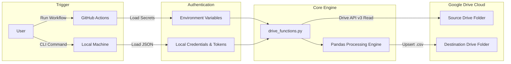
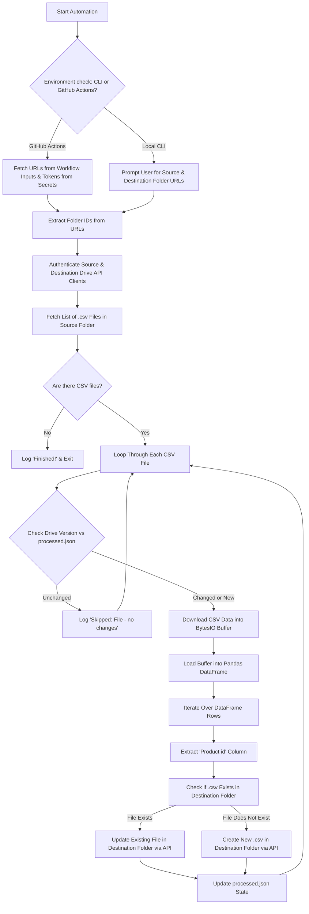

# 🚀 Google Drive CSV Automation

> **Automated, cloud-ready Python pipeline for splitting and synchronizing Google Drive CSV files by Product ID using Google Drive API v3, Pandas, and GitHub Actions.**

---

## 📌 Table of Contents
1. [Project Overview](#-project-overview)
2. [How It Works](#-how-it-works)
3. [Architecture & Workflow Diagrams](#-architecture--workflow-diagrams)
4. [Input and Output Specifications](#-input-and-output-specifications)
5. [Prerequisites](#-prerequisites)
6. [Step-by-Step Replication & Setup Guide](#-step-by-step-replication--setup-guide)
   - [Step 1: Google Cloud Project & API Setup](#step-1-google-cloud-project--api-setup)
   - [Step 2: Local Environment Setup](#step-2-local-environment-setup)
   - [Step 3: Generate OAuth Tokens Locally](#step-3-generate-oauth-tokens-locally)
   - [Step 4: Run Automation Locally](#step-4-run-automation-locally)
   - [Step 5: GitHub Actions Setup & Repository Secrets](#step-5-github-actions-setup--repository-secrets)
   - [Step 6: Execute via GitHub Actions](#step-6-execute-via-github-actions)
7. [Repository File Structure](#-repository-file-structure)
8. [Codebase Technical Explanation](#-codebase-technical-explanation)
9. [Security & Credentials Handling](#-security--credentials-handling)
10. [Troubleshooting Guide](#-troubleshooting-guide)
11. [Current Limitations & Roadmap](#-current-limitations--roadmap)
12. [License & Maintenance](#-license--maintenance)

---

## 📖 Project Overview

This project automates the processing and splitting of multi-product CSV files stored in Google Drive. 

### The Problem
In inventory, e-commerce, or manufacturing workflows, source files containing data for hundreds of products are frequently uploaded as a single consolidated CSV file to Google Drive. Manually opening these files, filtering by `Product id`, and creating or updating separate individual CSV files for each product in a destination folder is tedious, error-prone, and unsustainable.

### The Automated Solution
With **Google Drive CSV Automation**:
- The automation connects to a designated **Source Google Drive Folder**.
- It identifies and downloads all `.csv` files inside the folder.
- It parses each row using **Pandas**.
- For every row, it extracts the `Product id` and either **creates** a new individual `<Product id>.csv` or **updates** the existing file in the **Destination Google Drive Folder**.
- It uses **version tracking** (`processed.json` / Google Drive File `version` metadata) to skip unchanged files and save execution bandwidth.
- It runs seamlessly both **locally** and in the cloud via **GitHub Actions** without requiring your local machine to stay turned on.

---

## ⚙️ How It Works

```text
+-----------------------+      +------------------------+      +-----------------------------+
| Source Google Drive    | ---> | Python Automation     | ---> | Destination Google Drive    |
| (Consolidated CSVs)   |      | (Pandas & Drive API)   |      | (Split <Product id>.csv)    |
+-----------------------+      +------------------------+      +-----------------------------+
```

1. **Dual Account Support**: Supports using separate Google Drive accounts for Source and Destination drives (or the same account for both).
2. **Version Tracking**: Avoids re-processing files that have not changed since the last execution.
3. **Upsert Logic**: Automatically checks if `<Product id>.csv` already exists in the destination folder. If it exists, the file content is updated; if not, a new CSV file is created.
4. **Cloud & Local Parity**: Executes locally via CLI prompts or headlessly via GitHub Actions secrets and workflow parameters.

---

## 📐 Architecture & Workflow Diagrams

### High-Level System Architecture



### Complete Execution Flowchart



---

## 📊 Input and Output Specifications

### Input File Format
Source files must be standard `.csv` files stored in your Source Google Drive folder containing a column named **`Product id`**.

**Example (`source_inventory.csv`):**
```csv
Product id,Product name,length,breadth,height
101,RFID Reader,21,35,42
102,Core Controller,33,56,22
103,iBMD Sensor,25,82,91
```

### Output File Structure
The automation creates or updates individual CSV files in your Destination Google Drive folder named `<Product id>.csv`.

**Generated Destination Files:**
```text
Destination Folder/
├── 101.csv
├── 102.csv
└── 103.csv
```

**`101.csv` Contents:**
```csv
Product id,Product name,length,breadth,height
101,RFID Reader,21,35,42
```

**`102.csv` Contents:**
```csv
Product id,Product name,length,breadth,height
102,Core Controller,33,56,22
```

**`103.csv` Contents:**
```csv
Product id,Product name,length,breadth,height
103,iBMD Sensor,25,82,91
```

---

## 📋 Prerequisites

Before starting, ensure you have:
1. **Python 3.11 or higher** installed on your system.
2. **Git** installed on your machine.
3. A **Google Account** (or two separate Google Accounts for source & destination).
4. Access to **Google Cloud Console** to create OAuth credentials.
5. A **GitHub Account** (if deploying the automated cloud workflow).

---

## 🚀 Step-by-Step Replication & Setup Guide

Follow these exact steps to replicate and run this project from start to finish.

---

### Step 1: Google Cloud Project & API Setup

To interact with Google Drive programmatically, you must create Google OAuth 2.0 credentials.

1. **Go to Google Cloud Console**:
   Visit [console.cloud.google.com](https://console.cloud.google.com/) and sign in with your Google account.

2. **Create a New Project**:
   - Click the project dropdown at the top navigation bar.
   - Click **New Project**.
   - Enter a Project Name (e.g., `Google-Drive-CSV-Sync`) and click **Create**.

3. **Enable Google Drive API**:
   - Navigate to **APIs & Services** > **Library**.
   - Search for `Google Drive API`.
   - Select it and click **Enable**.

4. **Configure OAuth Consent Screen**:
   - Go to **APIs & Services** > **OAuth consent screen**.
   - Select **External** (or **Internal** if using Google Workspace) and click **Create**.
   - Fill in mandatory fields: App Name (e.g. `Drive CSV Sync`), User Support Email, Developer Contact Email.
   - Click **Save and Continue**.
   - Under **Scopes**, click **Add or Remove Scopes**, search for `.../auth/drive`, select `https://www.googleapis.com/auth/drive`, and click **Update**.
   - Under **Test Users**, add the Google email addresses of your **Source** and **Destination** Google accounts.
   - Click **Save and Continue**.

5. **Create OAuth Client ID Credentials**:
   - Go to **APIs & Services** > **Credentials**.
   - Click **+ Create Credentials** > **OAuth client ID**.
   - Select **Application type**: `Desktop app`.
   - Set Name: `Drive Automation Client`.
   - Click **Create**.
   - Click **Download JSON** in the popup modal.
   - Save the downloaded file as **`credentials.json`** in your root project folder.

> [!IMPORTANT]
> Keep `credentials.json` secure! Never commit `credentials.json` to public Git repositories.

---

### Step 2: Local Environment Setup

1. **Clone the Repository**:
   ```bash
   git clone https://github.com/Dhanush104/google-drive-csv-automation.git
   cd google-drive-csv-automation
   ```

2. **Create and Activate Virtual Environment (Optional but Recommended)**:
   - **Windows (PowerShell)**:
     ```powershell
     python -m venv venv
     .\venv\Scripts\Activate.ps1
     ```
   - **Linux / macOS**:
     ```bash
     python3 -m venv venv
     source venv/bin/activate
     ```

3. **Install Required Python Dependencies**:
   ```bash
   pip install -r requirements.txt
   ```

   The required packages include:
   - `pandas` — for parsing and writing CSV data.
   - `google-api-python-client` — official Google API Python SDK.
   - `google-auth-httplib2` & `google-auth-oauthlib` — OAuth 2.0 helper libraries.

---

### Step 3: Generate OAuth Tokens Locally

Because the pipeline authenticates headlessly in GitHub Actions, you must generate local authorization tokens (`source_token.json` and `destination_token.json`) first via browser login.

1. **Ensure `credentials.json` is in the project root directory**.
2. **Run the Python script locally**:
   ```bash
   python drive_functions.py
   ```

3. **Authorize Source Google Account**:
   - The script will launch your web browser asking you to log into the **Source Google Account** (the account owning the input CSV folder).
   - Click **Allow** to grant Google Drive permissions.
   - Once completed, a `source_token.json` file will be generated in your project directory.

4. **Authorize Destination Google Account**:
   - Next, the script will open another browser tab requesting login for the **Destination Google Account** (the account owning the output folder).
   - Log into the destination account and click **Allow**.
   - Once completed, a `destination_token.json` file will be generated in your project directory.

> [!NOTE]
> If you are using the same Google account for both source and destination folders, authenticate with that single account during both prompt flows.

---

### Step 4: Run Automation Locally

When executing locally, the script asks for Google Drive folder URLs if environment variables are not set:

1. Obtain your Drive folder URLs from your browser address bar:
   - **Source Folder URL Example**: `https://drive.google.com/drive/u/0/folders/1A2b3C4d5E6f7G8h9I0j`
   - **Destination Folder URL Example**: `https://drive.google.com/drive/u/1/folders/9Z8y7X6w5V4u3T2s1R0q`

2. Run the script:
   ```bash
   python drive_functions.py
   ```

3. Enter the requested inputs:
   ```text
   Enter Source Folder URL: https://drive.google.com/drive/u/0/folders/YOUR_SOURCE_FOLDER_ID
   Enter Destination Folder URL: https://drive.google.com/drive/u/1/folders/YOUR_DESTINATION_FOLDER_ID
   ```

4. **Observe Output**:
   ```text
   Processing: inventory_batch_1.csv
   Created: 101.csv
   Created: 102.csv
   Created: 103.csv
   Finished!
   ```

5. **Second Run Test (Version Checking)**:
   Run `python drive_functions.py` again without modifying the source CSV file. You will see:
   ```text
   Skipped: inventory_batch_1.csv - no changes
   Finished!
   ```

---

### Step 5: GitHub Actions Setup & Repository Secrets

To run the automation on GitHub Actions without needing your local computer online:

1. **Push your code to GitHub** (Ensure `credentials.json` and `*_token.json` are listed in `.gitignore` and **NOT** pushed).
2. Open your repository on GitHub.
3. Go to **Settings** > **Secrets and variables** > **Actions**.
4. Click **New repository secret** and add the following 3 secrets:

| Secret Name | Source Content | Description |
|-------------|----------------|-------------|
| `GOOGLE_CREDENTIALS` | Contents of `credentials.json` | OAuth Client ID credentials JSON |
| `SOURCE_TOKEN` | Contents of `source_token.json` | Authorized OAuth token for source Drive |
| `DESTINATION_TOKEN` | Contents of `destination_token.json` | Authorized OAuth token for destination Drive |

> [!TIP]
> Open `credentials.json`, `source_token.json`, and `destination_token.json` in a text editor, copy the entire raw JSON text, and paste it into the respective secret field.

---

### Step 6: Execute via GitHub Actions

1. Go to the **Actions** tab in your GitHub repository.
2. Under **Workflows** on the left, click **Google Drive CSV Automation**.
3. Click the **Run workflow** dropdown on the right side.
4. Input your folder URLs:
   - **Google Drive source folder URL**: Paste full source folder URL.
   - **Google Drive destination folder URL**: Paste full destination folder URL.
5. Click **Run workflow**.

```text
GitHub Actions UI:
┌────────────────────────────────────────────────────────┐
│ Run workflow                                           │
│                                                        │
│ Google Drive source folder URL                         │
│ [ https://drive.google.com/drive/u/0/folders/xxxx... ] │
│                                                        │
│ Google Drive destination folder URL                    │
│ [ https://drive.google.com/drive/u/1/folders/yyyy... ] │
│                                                        │
│ [ Run workflow ]                                       │
└────────────────────────────────────────────────────────┘
```

6. Click on the running job to monitor logs in real-time.

---

## 📁 Repository File Structure

```text
google-drive-csv-automation/
│
├── .github/
│   └── workflows/
│       └── drive_sync.yml        # GitHub Actions workflow file
│
├── drive_functions.py            # Core Python automation script
├── requirements.txt              # Required Python packages
├── .gitignore                    # Prevents secret credentials leakage
└── README.md                     # Project documentation
```

### Local Runtime Files (Ignored by Git)
```text
├── credentials.json              # Downloaded Google OAuth Desktop Client credentials
├── source_token.json             # Generated OAuth token for Source Account
├── destination_token.json        # Generated OAuth token for Destination Account
└── processed.json                # Local state file for tracking processed file versions
```

---

## 🔍 Codebase Technical Explanation

### Key Functions in `drive_functions.py`

#### 1. `get_folder_id(url)`
Extracts the unique Google Drive folder ID string from full web browser URLs using string parsing.
```python
def get_folder_id(url):
    return url.split("/folders/")[1].split("?")[0]
```

#### 2. `login(token_file)`
Handles dual-mode authentication. In GitHub Actions, it parses environment variables (`SOURCE_TOKEN` / `DESTINATION_TOKEN`). In local mode, it handles token refresh or opens local OAuth flows using `credentials.json`.
```python
def login(token_file):
    ...
```

#### 3. `get_csv_files(drive, folder_id)`
Executes paginated Drive API `files().list()` queries to retrieve all non-trashed `.csv` files inside the target folder, fetching `id, name, mimeType, version`.

#### 4. `find_file(drive, filename, folder_id)`
Searches destination folder for pre-existing output files (e.g. `101.csv`) to determine whether to perform an `update` or `create` API call.

#### 5. `download_csv(drive, file_id)` & `upload_csv(drive, row, filename, folder_id)`
- `download_csv`: Downloads Drive file bytes directly into an in-memory `io.BytesIO` buffer and parses it with `pd.read_csv()`.
- `upload_csv`: Converts a single row DataFrame into CSV byte streams (`MediaIoBaseUpload`) and uploads it to Google Drive using `files().create()` or `files().update()`.

---

## 🔒 Security & Credentials Handling

To prevent unauthorized access to your Google Drive data:

- **`.gitignore` Rules**: Always verify sensitive files are ignored before committing:
  ```gitignore
  __pycache__/
  *.pyc
  credentials.json
  source_token.json
  destination_token.json
  processed.json
  ```
- **Environment Variables**: In production (GitHub Actions), tokens and credentials are standard JSON strings injected via encrypted repository secrets.
- **Minimal OAuth Scope**: The project uses `https://www.googleapis.com/auth/drive`. If limited scope is desired, scope down according to organizational requirements.

---

## 🛠️ Troubleshooting Guide

### 1. `Finished!` with No Output Files Created
- **Cause**: No `.csv` files found directly inside the source folder, or files are in a subfolder.
- **Fix**: Verify source CSV file has extension `.csv`, is uploaded as plain text CSV (not Google Sheet format), and is located directly in the root of the source folder.

### 2. `google.auth.exceptions.RefreshError` or Token Expired
- **Cause**: OAuth token has expired or consent screen test user permissions changed.
- **Fix**: Delete local `source_token.json` and `destination_token.json`, rerun `python drive_functions.py` locally to re-authenticate, and update GitHub Secrets with new token contents.

### 3. KeyError: `'Product id'`
- **Cause**: Input CSV file header does not match expected column name.
- **Fix**: Ensure your CSV file has a column header named exact string `Product id` (case sensitive).

### 4. GitHub Actions Secret Error / Invalid JSON
- **Cause**: Secret value pasted into GitHub Secrets had missing quotes or formatting issues.
- **Fix**: Copy raw JSON file contents entirely without modifying or truncating any lines.

---

## 🛣️ Current Limitations & Roadmap

### Current Limitations
- **Folder Traversal**: Processes files directly inside the given folder; does not recursively scan subfolders.
- **Ephemeral Runner State**: In GitHub Actions, `processed.json` is recreated per run unless persistent state storage (e.g., S3 / Drive / DB) is configured.

### Feature Roadmap
- [ ] Add Cron schedule support in GitHub Actions (`schedule` trigger).
- [ ] Persist `processed.json` state to a Google Drive file or cloud database.
- [ ] Add recursive subfolder processing capability.
- [ ] Add Slack / Email webhook notifications on sync completion or failures.
- [ ] Add input schema validation for custom column mappings.

---

## 📄 License & Maintenance

Maintained by **Dhanush** ([GitHub @Dhanush104](https://github.com/Dhanush104)). Distributed under open guidelines.
