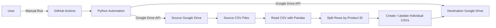
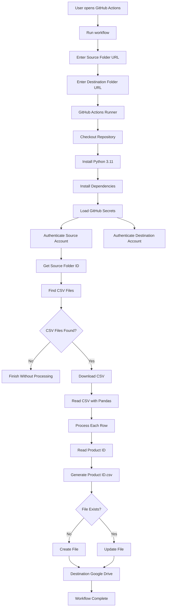
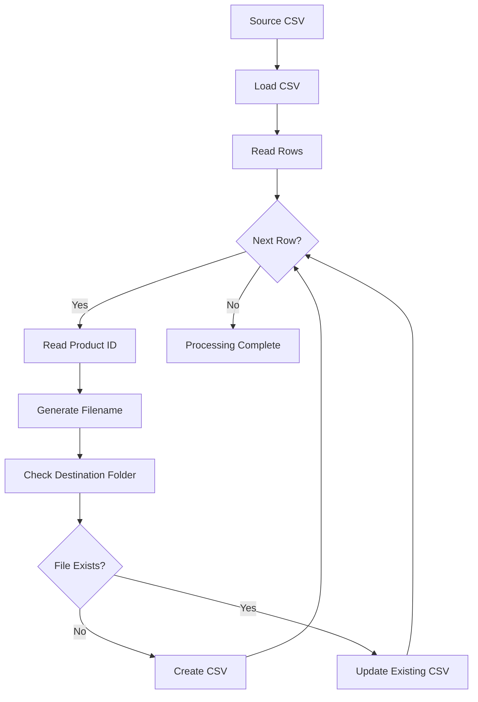
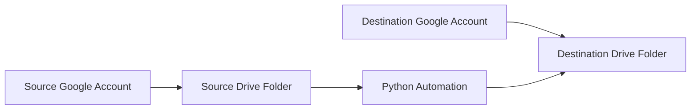
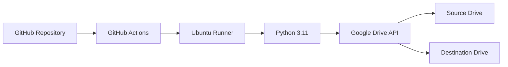
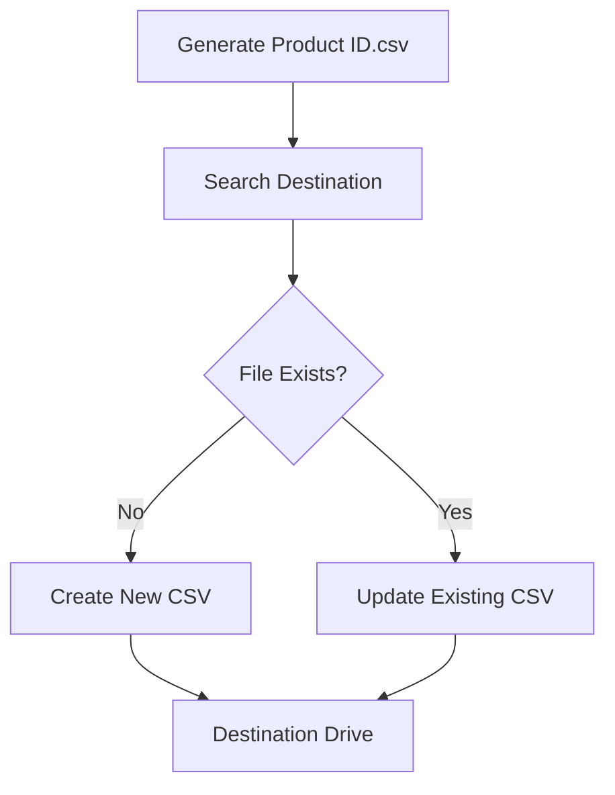
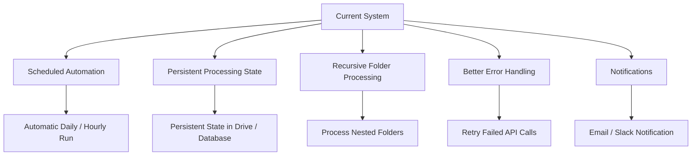

from pathlib import Path

readme = r'''# Google Drive CSV Automation

Automate the processing of CSV files stored in Google Drive using the **Google Drive API**, **Python**, and **GitHub Actions**.

The automation reads CSV files from a source Google Drive folder, processes each row, and creates or updates a separate CSV file for each `Product id` in a destination Google Drive folder.

---

## 1. Project Overview

This project was created to automate a repetitive Google Drive data-processing workflow.

### Problem

Suppose a source Google Drive folder contains a CSV file like:

```csv
Product id,Product name,length,breadth,height
101,RFID,21,35,42
102,core,33,56,22
103,ibmd,25,82,91
```

Manually creating individual CSV files for every product is repetitive.

### Solution

The Python automation:

1. Connects to the source Google Drive account.
2. Reads CSV files from the selected source folder.
3. Processes each CSV row.
4. Uses `Product id` as the output filename.
5. Creates or updates the corresponding CSV in the destination folder.
6. Runs from GitHub Actions without requiring the user's computer to stay online.

---

## 2. Key Features

- Google Drive API integration
- Separate source and destination Google accounts
- OAuth authentication
- CSV processing with Pandas
- One output CSV per product
- Create-or-update behavior for output files
- Source file version tracking
- `processed.json` state tracking for local execution
- Manual GitHub Actions execution
- Source and destination folder URLs supplied at workflow runtime
- Credentials stored securely in GitHub Secrets
- Local execution support
- No Google Drive for Desktop required
- No AWS Lambda required

---

## 3. High-Level Architecture



---

## 4. Complete Workflow



---

## 5. Input and Output

### Input

A CSV file stored directly inside the selected source Google Drive folder.

Example:

```csv
Product id,Product name,length,breadth,height
101,RFID,21,35,42
102,core,33,56,22
103,ibmd,25,82,91
```

### Output

The automation creates:

```text
101.csv
102.csv
103.csv
```

### `101.csv`

```csv
Product id,Product name,length,breadth,height
101,RFID,21,35,42
```

### `102.csv`

```csv
Product id,Product name,length,breadth,height
102,core,33,56,22
```

### `103.csv`

```csv
Product id,Product name,length,breadth,height
103,ibmd,25,82,91
```

---

## 6. Processing Logic



The output filename is generated using:

```text
<Product id>.csv
```

For example:

```text
101 → 101.csv
102 → 102.csv
103 → 103.csv
```

---

## 7. Project Structure

```text
google-drive-csv-automation/
│
├── drive_functions.py
├── requirements.txt
├── .gitignore
├── README.md
│
└── .github/
    └── workflows/
        └── drive_sync.yml
```

### Local-only files

The following files are intentionally **not committed to GitHub**:

```text
credentials.json
source_token.json
destination_token.json
processed.json
```

They are protected by `.gitignore`.

---

## 8. Technologies Used

| Technology | Purpose |
|---|---|
| Python | Automation logic |
| Pandas | CSV processing |
| Google Drive API | Reading and writing Drive files |
| Google OAuth 2.0 | Google account authentication |
| Git | Version control |
| GitHub | Source code repository |
| GitHub Actions | Cloud execution |
| YAML | Workflow configuration |
| Mermaid | Documentation diagrams |

---

# 9. Prerequisites

Before using the project, install or configure:

- Python 3.11+
- Git
- A Google account with access to the source folder
- A Google account with access to the destination folder
- Google Cloud project
- Google Drive API enabled
- OAuth 2.0 Desktop application credentials
- GitHub repository

---

# 10. Google Drive API Setup

## Step 1 — Create a Google Cloud Project

Open Google Cloud Console and create a project.

## Step 2 — Enable Google Drive API

Enable:

```text
Google Drive API
```

for the project.

## Step 3 — Configure OAuth Consent

Configure the OAuth consent screen for the application.

## Step 4 — Create OAuth Credentials

Create an OAuth Client ID using the:

```text
Desktop application
```

application type.

Download the credentials JSON file.

Rename it to:

```text
credentials.json
```

Place it in the local project directory.

> Do not upload `credentials.json` to GitHub.

---

# 11. Two Google Drive Accounts

This project uses two Drive identities:



### Source account

Used to:

- Read source folders
- Find CSV files
- Download CSV data

### Destination account

Used to:

- Find existing output CSVs
- Create new output CSVs
- Update existing output CSVs

Each account has its own OAuth token.

Local token files:

```text
source_token.json
destination_token.json
```

---

# 12. Local Authentication

When the project is first run locally, Google OAuth authentication creates token files.

The tokens allow the application to reuse the authorized Google account without requiring authentication every time.

Expected local files:

```text
credentials.json
source_token.json
destination_token.json
```

These files must remain private.

---

# 13. Local Installation

Clone the repository:

```bash
git clone https://github.com/Dhanush104/google-drive-csv-automation.git
```

Move into the project:

```bash
cd google-drive-csv-automation
```

Install dependencies:

```bash
pip install -r requirements.txt
```

---

# 14. Requirements

The project uses:

```text
pandas
google-api-python-client
google-auth-httplib2
google-auth-oauthlib
```

Install them with:

```bash
pip install -r requirements.txt
```

---

# 15. Run Locally

Run:

```bash
python drive_functions.py
```

The script asks for:

```text
Enter Source Folder URL:
Enter Destination Folder URL:
```

Provide the Google Drive folder URLs.

Example:

```text
Source:
https://drive.google.com/drive/u/0/folders/SOURCE_FOLDER_ID

Destination:
https://drive.google.com/drive/u/1/folders/DESTINATION_FOLDER_ID
```

The application extracts the folder IDs from these URLs.

---

# 16. GitHub Actions

The project can run without keeping the local computer online.



The current workflow is:

```text
Manual trigger
      ↓
GitHub Actions
      ↓
Checkout repository
      ↓
Set up Python
      ↓
Install dependencies
      ↓
Load secrets
      ↓
Run Python automation
      ↓
Google Drive
```

---

# 17. GitHub Repository Secrets

The project does not commit Google credentials to GitHub.

The following repository secrets are required:

```text
GOOGLE_CREDENTIALS
SOURCE_TOKEN
DESTINATION_TOKEN
```

### `GOOGLE_CREDENTIALS`

Contains the complete contents of:

```text
credentials.json
```

### `SOURCE_TOKEN`

Contains the complete contents of:

```text
source_token.json
```

### `DESTINATION_TOKEN`

Contains the complete contents of:

```text
destination_token.json
```

Never expose these values in source code, README files, screenshots, issues, or logs.

---

# 18. GitHub Actions Workflow Inputs

The workflow accepts two inputs:

```text
source_folder_url
destination_folder_url
```

This allows the user to select different source and destination folders every time the workflow is manually executed.

Example:

```text
Source Folder URL:
https://drive.google.com/drive/u/0/folders/xxxxxxxx

Destination Folder URL:
https://drive.google.com/drive/u/1/folders/yyyyyyyy
```

---

# 19. Running the Workflow

Go to:

```text
GitHub Repository
    ↓
Actions
    ↓
Google Drive CSV Automation
    ↓
Run workflow
```

Enter:

```text
Source folder URL
Destination folder URL
```

Then click:

```text
Run workflow
```

---

# 20. GitHub Actions Workflow File

The workflow is stored at:

```text
.github/workflows/drive_sync.yml
```

Current workflow:

```yaml
name: Google Drive CSV Automation

on:
  workflow_dispatch:
    inputs:
      source_folder_url:
        description: "Google Drive source folder URL"
        required: true
        type: string

      destination_folder_url:
        description: "Google Drive destination folder URL"
        required: true
        type: string

jobs:
  run-automation:
    runs-on: ubuntu-latest

    env:
      GOOGLE_CREDENTIALS: ${{ secrets.GOOGLE_CREDENTIALS }}
      SOURCE_TOKEN: ${{ secrets.SOURCE_TOKEN }}
      DESTINATION_TOKEN: ${{ secrets.DESTINATION_TOKEN }}
      SOURCE_FOLDER_URL: ${{ inputs.source_folder_url }}
      DESTINATION_FOLDER_URL: ${{ inputs.destination_folder_url }}

    steps:
      - name: Checkout repository
        uses: actions/checkout@v4

      - name: Set up Python
        uses: actions/setup-python@v5
        with:
          python-version: "3.11"

      - name: Install dependencies
        run: |
          pip install -r requirements.txt

      - name: Run Google Drive automation
        run: |
          python drive_functions.py
```

---

# 21. Source Folder Requirement

The current implementation searches for CSV files **directly inside the selected source folder**.

Example:

```text
Source Folder
│
├── products.csv       ← detected
├── inventory.csv      ← detected
│
└── Subfolder
    └── data.csv       ← not detected
```

The current implementation does not recursively search subfolders.

---

# 22. Create vs Update Behavior

Before creating an output file, the application checks whether the file already exists in the destination folder.



This prevents unnecessary duplicate files.

---

# 23. Change Detection

The application also tracks the Google Drive file version.

Conceptually:

```text
Source File
     ↓
Get Drive File Version
     ↓
Compare With Previous Version
     ↓
Changed?
 ┌───────┴───────┐
 No              Yes
 ↓                ↓
Skip            Process
```

For local execution, the processed state is stored in:

```text
processed.json
```

Example:

```json
{
    "google-drive-file-id": "123"
}
```

This helps avoid processing unchanged source files.

> Note: GitHub Actions runners are temporary environments. Because `processed.json` is intentionally not committed to the repository, persistent change tracking across separate GitHub Actions runs should be improved in a future version.

---

# 24. Security

Sensitive files are excluded through `.gitignore`.

Current protected files:

```gitignore
__pycache__/
*.pyc

credentials.json
source_token.json
destination_token.json
processed.json
```

### Never commit:

```text
credentials.json
source_token.json
destination_token.json
```

### Recommended security practices

- Use GitHub Secrets for credentials.
- Never print token contents.
- Never hard-code OAuth client secrets.
- Keep the repository private when appropriate.
- Give Google accounts only the required Drive access.
- Rotate credentials if they are accidentally exposed.

---

# 25. Troubleshooting

## Workflow succeeds but no output files appear

Check the GitHub Actions log for:

```text
Processing:
Created:
Updated:
Skipped:
```

If the log only shows:

```text
Finished!
```

then the source folder likely returned zero CSV files.

Check:

1. The source folder URL is correct.
2. A CSV exists directly inside the source folder.
3. The source Google account has access to the folder.
4. The file has a `.csv` extension.
5. The CSV is not inside a subfolder.

---

## Authentication error

Check:

```text
GOOGLE_CREDENTIALS
SOURCE_TOKEN
DESTINATION_TOKEN
```

in:

```text
GitHub
→ Settings
→ Secrets and variables
→ Actions
```

Do not paste credentials into the Python source code.

---

## Local authentication works but GitHub fails

Check that the GitHub Secrets contain the complete JSON contents of the corresponding local files.

Required mapping:

```text
credentials.json
      ↓
GOOGLE_CREDENTIALS

source_token.json
      ↓
SOURCE_TOKEN

destination_token.json
      ↓
DESTINATION_TOKEN
```

---

## Output files are duplicated

The application searches the destination folder before creating a file.

If duplicates still occur, verify that:

- The destination folder URL is correct.
- The `Product id` values are unique.
- The destination account has permission to see existing files.

---

# 26. Current Limitations

The current implementation has several limitations:

- Source search is not recursive.
- GitHub Actions currently runs manually.
- Persistent `processed.json` state is not maintained between ephemeral GitHub runners.
- The workflow does not currently run on a schedule.
- There is no email/Slack notification system.
- CSV validation can be improved.
- Error handling and retry logic can be expanded.
- Duplicate `Product id` handling can be improved.
- Large CSV processing can be optimized further.

---

# 27. Future Improvements

Possible next versions:



Potential improvements include:

### 1. Scheduled execution

Add a GitHub Actions cron trigger.

### 2. Persistent state

Move processing state from the temporary runner to a persistent location such as:

- Google Drive
- Database
- GitHub-managed state

### 3. Recursive processing

Allow the automation to process CSV files inside nested folders.

### 4. Validation

Validate:

- Required columns
- Empty `Product id`
- Duplicate product IDs
- Invalid CSV files

### 5. Logging

Generate structured logs containing:

```text
Source file
Rows processed
Files created
Files updated
Files skipped
Errors
Execution time
```

### 6. Notifications

Send a notification when:

- Processing succeeds
- Processing fails
- Files are created
- Files are skipped
- Authentication fails

---

# 28. Example End-to-End Execution

```text
User
 │
 │ Run workflow
 ▼
GitHub Actions
 │
 ├── Checkout repository
 ├── Install Python
 ├── Install dependencies
 ├── Load Google credentials
 │
 ▼
Source Google Drive
 │
 └── products.csv
       │
       ▼
    Pandas
       │
       ├── Product 101
       ├── Product 102
       └── Product 103
       │
       ▼
Destination Google Drive
 │
 ├── 101.csv
 ├── 102.csv
 └── 103.csv
```

---

# 29. Git Workflow

The project uses Git for version control.

Typical workflow:

```bash
git status

git add .

git commit -m "Describe the change"

git push
```

The repository is hosted on GitHub.

---

# 30. Project Status

### Current implementation

| Component | Status |
|---|---|
| Python CSV processing | Implemented |
| Google Drive API | Implemented |
| Source account authentication | Implemented |
| Destination account authentication | Implemented |
| Create output CSV | Implemented |
| Update existing CSV | Implemented |
| Local execution | Implemented |
| GitHub repository | Implemented |
| GitHub Actions | Implemented |
| Manual workflow trigger | Implemented |
| Workflow folder inputs | Implemented |
| GitHub Secrets | Implemented |
| Scheduled execution | Future improvement |
| Persistent cloud state | Future improvement |
| Recursive folder processing | Future improvement |
| Notifications | Future improvement |

---

# 31. Summary

This project converts a manual Google Drive CSV-processing task into a repeatable Python automation.

The overall system is:

```text
Google Drive
     ↓
Google Drive API
     ↓
Python + Pandas
     ↓
Split CSV by Product ID
     ↓
Create / Update individual CSVs
     ↓
Destination Google Drive
```

GitHub Actions provides the execution environment:

```text
User
 ↓
GitHub Actions
 ↓
Python
 ↓
Google Drive API
 ↓
Destination Drive
```

The current workflow is manually triggered, allowing the user to select the source and destination folders for each execution. Future versions can add scheduled execution, persistent state, recursive processing, notifications, and improved monitoring.

---

## License

Add an appropriate license if this project is intended to be distributed publicly.
'''

path = Path("/mnt/data/README.md")
path.write_text(readme, encoding="utf-8")
print(f"Created: {path}")
print(f"Size: {path.stat().st_size} bytes")
